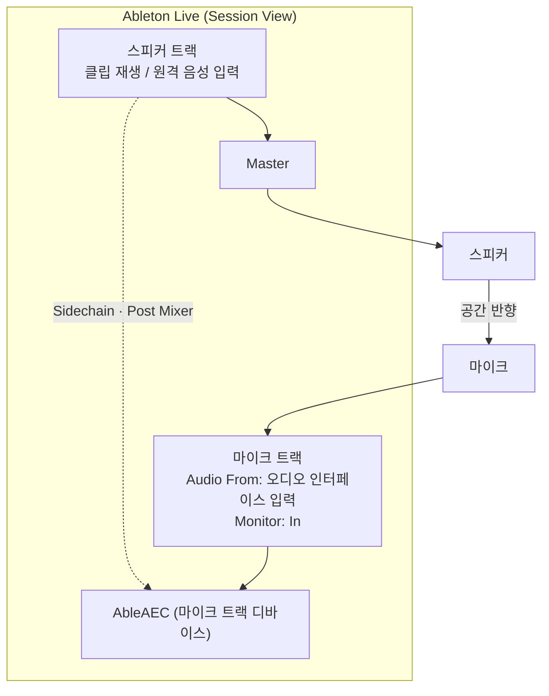

# Ableton Live 설정 가이드

[[README|AbleAEC]]를 세션 뷰의 마이크 트랙에 넣고, 스피커로 나가는 트랙을 사이드체인으로 연결하는 방법입니다.
설치는 [[build|빌드 및 설치]]를 참고하세요.

> [!note] 지원 환경
> Ableton Live는 Linux 버전이 없으므로 **Windows / macOS**에서 사용합니다. 서드파티 플러그인 사이드체인은 **Live 11 이상**을 권장합니다 (VST3 / AU 모두 사이드체인 입력이 표시됨).

## 1. 트랙 구성

| 트랙 | 설정 |
| --- | --- |
| 스피커 트랙 | 스피커로 내보낼 소리(클립, 원격 통화 음성 등). 출력 → Master |
| 마이크 트랙 | `Audio From` = 마이크가 연결된 인터페이스 입력, `Monitor` = **In** (또는 Auto + Arm) |

## 2. 플러그인 삽입과 사이드체인 연결

1. 브라우저 → **Plug-ins** → `AbleAEC`를 **마이크 트랙**에 끌어다 놓습니다.
2. 디바이스 제목줄의 **펼치기(▼) 버튼**을 눌러 사이드체인 섹션을 엽니다.
3. **Sidechain** 을 켭니다.
4. `Audio From` = **스피커 트랙**, 탭 위치 = **Post Mixer** (볼륨 페이더까지 반영 → 실제 스피커로 나가는 소리와 가장 비슷함).
5. 플러그인 화면 오른쪽 상태창이 `Sidechain: receiving` 이 되는지 확인합니다.
6. 스피커 소리를 재생하고 몇 초 기다리면 `Echo reduction` 값이 올라가고 `State: converged` 가 됩니다.

> [!warning] Master를 사이드체인 소스로 쓰지 마세요 (마이크가 Master로 가는 경우)
> 마이크 트랙이 Master로 출력되면 Master 신호 안에 마이크(근단) 소리도 들어 있습니다. 이를 참조로 쓰면 AEC가 **말소리 자체를 지우려 합니다.** 사이드체인은 반드시 *스피커로 나가는 소리만 있는 트랙*에서 받으세요. 스피커 소스가 여러 트랙이면 그룹 트랙이나 리턴 트랙으로 묶어서 그 트랙을 사이드체인 소스로 지정합니다.

> [!warning] 같은 오디오 인터페이스 사용
> 스피커 출력과 마이크 입력은 **같은 오디오 인터페이스(같은 클럭)** 여야 합니다. 서로 다른 장치(예: 노트북 내장 스피커 + USB 마이크, Live의 Aggregate Device)는 클럭 드리프트 때문에 에코 경로가 계속 변해 제거 성능이 크게 떨어집니다.

## 3. 파라미터

| 파라미터 | 기본값 | 설명 |
| --- | --- | --- |
| Filter Length | 200 ms | 적응 필터가 덮는 에코 길이. **에코 지연 + 잔향 시간** 이상이어야 함. 넓은/울리는 방은 300–500 ms |
| Adapt Speed | 50 % | 백그라운드 필터 학습 속도. 높을수록 빨리 수렴하지만 잡음에 민감 |
| Ref Delay | 0 ms | 참조 신호를 미리 지연. 에코 지연이 매우 크면(예: 블루투스 스피커, 외부 처리) 그만큼 지정해서 필터 길이를 아낌 |
| Residual Supp. | 50 % | 잔여 에코 억제 강도. 0 % = 끔. 높이면 에코는 더 줄지만 더블토크 시 말소리가 약간 뭉개질 수 있음 |
| Supp. Floor | -30 dB | 잔여 에코 억제기의 최대 감쇄량 |
| Output | Clean | `Clean`(AEC+억제), `Linear AEC only`, `Echo estimate`(추정 에코만, 확인용), `Raw mic`(원본, 지연만 맞춤) |
| Freeze | off | 학습 정지 (현재 필터 유지) |
| AEC Off | off | 처리 없이 원본 마이크를 내보냄 (지연은 동일하게 유지) |
| Reset Filter | — | 학습된 필터 초기화 (마이크/스피커 위치를 크게 바꾼 뒤) |

자세한 알고리즘은 [[dsp-design|DSP 설계]] 참고.

## 화면 읽는 법

- **Speaker / Mic in / Output** 미터: 사이드체인 참조, 마이크 입력, 처리 결과 레벨
- **Sidechain**: `not connected`(사이드체인 꺼짐) / `connected, no signal` / `receiving`
- **Echo reduction (ERLE)**: 스피커 소리만 날 때 마이크 대비 출력이 얼마나 줄었는지(선형 필터 기준). 15 dB 이상이면 양호, 25 dB 이상이면 매우 좋음. 말하는 중에는 낮게 표시되는 것이 정상
- **Echo delay**: 스피커 → 마이크 총 지연 추정값 (인터페이스 왕복 지연 + 음향 경로 + Ref Delay)

## 4. 문제 해결

| 증상 | 원인 / 조치 |
| --- | --- |
| `Sidechain: not connected` | 디바이스를 펼쳐 Sidechain 토글을 켜고 `Audio From`을 지정 |
| `connected, no signal` | 스피커 트랙이 재생 중인지, 탭 위치가 Post Mixer인데 페이더가 내려가 있지 않은지 확인 |
| ERLE가 계속 낮음 (< 6 dB) | Echo delay 값이 Filter Length 끝 근처라면 Filter Length를 늘리거나 Ref Delay 지정. 스피커/마이크가 다른 장치인지 확인 |
| 말할 때 목소리가 뭉개짐 | Residual Supp.를 낮추거나 Supp. Floor를 -15 dB 정도로 올림 |
| 에코가 조금 남음 | Residual Supp. 를 높임. 스피커 볼륨이 너무 커서 왜곡되면 볼륨을 낮춤 |
| 모니터링이 약간 늦게 들림 | 플러그인 지연 512 샘플(48 kHz에서 약 10.7 ms). 녹음은 Live가 자동 보정 |

## 관련 문서

- [[AbleAEC-MOC|문서 목차]]
- [[dsp-design|DSP 설계]]
- [[build|빌드 및 설치]]
