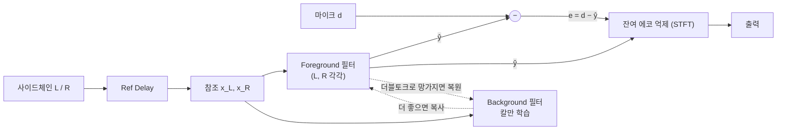

# DSP 설계

[[README|AbleAEC]]의 신호 처리 구조입니다. 코드는 `src/dsp/AecCore.cpp` 이며 JUCE에 의존하지 않아 [[build#테스트|오프라인 테스트]]와 [[realistic-test|보컬 + 반주 실환경 시뮬레이션]]으로 단독 검증합니다.

## 전체 흐름



## 1. 선형 적응 필터 — 분할 블록 주파수 영역 필터 (PB-FDAF)

- overlap-save, FFT 크기 `N = 2B`
- 블록 크기 `B` 는 Latency 모드와 샘플레이트로 결정 (`AecCore::blockSizeFor`)

| Latency 모드 | 44.1 / 48 kHz | 88.2 / 96 kHz | 주파수 칸 간격 (48 kHz) |
| --- | --- | --- | --- |
| Quality (기본) | 512 | 1024 | 47 Hz |
| Low | 256 | 512 | 94 Hz |

- 필터를 `P = ceil(FilterLength × fs / B)` 개의 파티션으로 나눔 (48 kHz, Quality, 250 ms → 24 파티션)
- **참조 채널별 필터**: `Ŷ(k) = Σ_c Σ_p W_{c,p}(k) · X_{c,p}(k)` (c = L, R). 스피커 2대에서 마이크까지의 경로가 서로 다르므로 L/R을 모노로 합치면 모델링이 불가능 → 스테레오 참조가 기본 (`Reference: Mono (L+R)` 로 전환 가능)
- 시간 영역 인과성 제약(gradient constraint)은 블록마다 2개 파티션씩 순환 적용

## 2. 칼만 필터 학습 (background)

주파수 영역 칼만 필터를 대각 근사한 방식입니다 (Kuech, Mabande & Enzner 2014).

```
den(k)     = Σ_c Σ_p Pc_{c,p}(k) |X_{c,p}(k)|²  +  (N/B) · Ψ(k)
W_{c,p}   += 2μ · Pc_{c,p}(k) / den(k) · conj(X_{c,p}(k)) · E(k)
Pc_{c,p}   = A² · (1 − ½ · Pc |X|² / den) · Pc  +  (1 − A²)|W|²  +  q
Ψ(k)       = 0.5 Ψ(k) + 0.5 |E(k)|²        (관측 잡음 = 보컬 + 잡음 + 잔여)
```

- `Pc` (상태 불확실도)가 (채널, 파티션, 주파수)마다 따로 있음 → **처음 나타나는 주파수(새 코드, 새 악기)는 즉시 빠르게 학습**하고, 이미 배운 주파수는 안정적으로 유지
- 보컬이 크면 `Ψ` 가 커져 학습이 **자동으로 느려짐** (더블토크에 강함)
- `A = 0.999`, `q = 1e-8`, `Pc` 초기값 1, `μ` = Adapt Speed (기본 0.5 → 이득 1)
- **에코 경로 변화 감지**: leakage `η > 0.5` (오차가 여전히 에코 추정과 강하게 상관 = 마이크/스피커 이동) 이면 `Pc` 를 블록마다 1.5배 키워 재학습. 보컬은 참조와 상관이 없어 이 조건을 거의 만족하지 않음

이전 버전(고정 스텝 NLMS)과 비교: [[realistic-test#개선 이력 (이 테스트로 찾은 문제)|개선 이력]]

## 3. 2-경로(foreground / background) 구조

| 조건 (평활 에너지 기준) | 동작 |
| --- | --- |
| background 오차 < foreground 오차 × 0.8 이 2블록 연속 | background 계수를 foreground로 복사 |
| background 오차 > foreground 오차 × 2 가 4블록 연속 | background를 foreground로 되돌림 (더블토크로 학습이 망가진 경우) |
| foreground 오차 > 마이크 × 8 | 발산으로 보고 전체 초기화 (안전장치) |

출력은 항상 foreground 필터 결과를 씁니다.

## 4. 잔여 에코 억제 (RES)

- STFT (sqrt-Hann 창, 50 % 겹침, N점)
- 잔여 에코 추정: `R(k) = 4·amount · max(η, 0.02) · |Ŷ(k)|²`
  - `η` (leakage): 오차 스펙트럼 변동과 에코 추정 스펙트럼 변동의 상관 (Valin 2007)
- 이득: `G(k) = max(floor, 1 − R / |E|²)`, 빠른 attack / 느린 release로 평활
- 기본값 amount 20 %, floor -18 dB ([[realistic-test#해석|보컬 보존과의 균형]])
- `amount = 0` 이거나 `Linear AEC only` 모드에서는 이득 1 (완전 복원 합성)

## 5. 에코 지연 추정

약 4096 샘플마다 foreground 필터(모든 참조 채널) 임펄스 응답의 최대 탭 위치를 찾아 `Echo delay` 로 표시합니다 (UI 값에는 Ref Delay가 더해짐).

## 지연(latency) 구조

| 단계 | Quality (48 kHz) | Low (48 kHz) |
| --- | --- | --- |
| 플러그인 블록 FIFO (`PluginProcessor`) | 512 | 256 |
| AecCore 내부 STFT 합성 | 512 | 256 |
| **합계 (호스트에 보고)** | **1024 샘플 ≈ 21.3 ms** | **512 샘플 ≈ 10.7 ms** |

- 모든 출력 모드가 같은 지연을 가지므로 전환해도 위상이 맞습니다 (`plugin_host_test` 검증).
- Latency 모드는 두 세트의 코어를 미리 준비해 두고 전환하므로 오디오 스레드에서 메모리 할당이 없습니다. 전환 시 필터는 초기화됩니다.
- 에코는 항상 참조보다 늦게 마이크에 도착하므로 인과적 필터로 모델링할 수 있습니다. 지연이 필터 길이에 비해 너무 크면 `Ref Delay` 로 참조를 늦춥니다.

## 채널 처리

- 참조: 스테레오 사이드체인이면 L/R 각각 (기본), 모노 사이드체인이거나 `Mono (L+R)` 선택 시 합산
- 마이크: 채널별 독립 처리. 모노 마이크를 스테레오 트랙에서 쓰는 경우(L == R) 한 번만 처리하고 복사

## CPU (48 kHz, 마이크 채널당, 단일 코어)

| 설정 | 250 ms | 500 ms |
| --- | --- | --- |
| Quality, 스테레오 참조 | 4.4 % | 6.9 % |
| Quality, 모노 참조 | 2.5 % | 3.9 % |
| Low, 스테레오 참조 | 5.8 % | 9.7 % |

## 한계

- 스피커 왜곡 같은 비선형 에코는 RES로만 줄임 (선형 필터는 비선형 성분을 못 지움)
- 처음 학습에 반주 기준 수 초–20초 필요 ([[realistic-test#해석|해석]])
- Low 모드는 음악 저역(킥·베이스) 처리 능력이 크게 떨어짐
- 잡음 제거(NS), 자동 이득(AGC), 컴포트 노이즈는 포함하지 않음
- 스피커와 마이크가 다른 클럭의 장치면 성능이 크게 저하됨 ([[ableton-setup#2. 플러그인 삽입과 사이드체인 연결|설정 가이드]] 참고)

## 관련 문서

- [[AbleAEC-MOC|문서 목차]]
- [[realistic-test|보컬 + 반주 실환경 시뮬레이션 테스트]]
- [[ableton-setup|Ableton 설정 가이드]]
- [[build|빌드 및 설치]]
