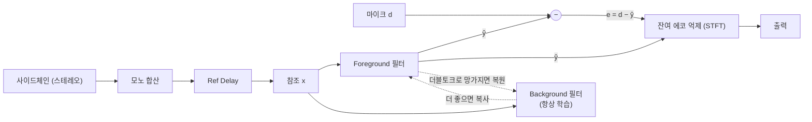

# DSP 설계

[[README|AbleAEC]]의 신호 처리 구조입니다. 코드는 `src/dsp/AecCore.cpp` 이며 JUCE에 의존하지 않아 [[build#테스트|오프라인 테스트]]로 단독 검증합니다.

## 전체 흐름

## 1. 선형 적응 필터 — PBFDAF

- 블록 크기 `B = 256`, FFT 크기 `N = 512`, overlap-save 방식
- 필터를 `P = ceil(FilterLength × fs / B)` 개의 파티션으로 나눔 (48 kHz, 200 ms → 38 파티션)
- 에코 추정: `Ŷ(k) = Σ_p W_p(k) · X_p(k)` (X_p = p 블록 전 참조 스펙트럼)
- 갱신: `W_p += μ · conj(X_p) · E / (Σ_p|X_p|² + 0.25·장기평균 + δ)` — 주파수별 정규화로 음성처럼 스펙트럼이 치우친 신호에서도 빠르게 수렴
- 장기평균 정규화 항은 말 사이 쉼(무음) 직후 약한 주파수 빈에서 스텝이 폭주하는 것을 막음
- 시간 영역 인과성 제약(gradient constraint)은 블록마다 2개 파티션씩 순환 적용 → 비용 절감

## 2. 2-경로(foreground / background) 구조

더블토크 검출기 없이 더블토크에 강하게 만드는 방법입니다 (Ochiai 외, Speex 방식).

| 조건 (평활 에너지 기준) | 동작 |
| --- | --- |
| background 오차 < foreground 오차 × 0.8 이 2블록 연속 | background 계수를 foreground로 복사 (에코 경로 변화에 빠르게 추종) |
| background 오차 > foreground 오차 × 2 가 4블록 연속 | background를 foreground로 되돌림 (더블토크로 학습이 망가진 경우) |
| foreground 오차 > 마이크 × 8 | 발산으로 보고 전체 초기화 (안전장치) |

출력은 항상 foreground 필터 결과를 씁니다. 그래서 근단 화자가 말하는 동안 background가 흔들려도 출력 품질이 유지됩니다.

## 3. 잔여 에코 억제 (RES)

- STFT (sqrt-Hann 창, 50 % 겹침, 512점)
- 잔여 에코 추정: `R(k) = 4·amount · max(η, 0.02) · |Ŷ(k)|²`
  - `η` (leakage): 오차 스펙트럼 변동과 에코 추정 스펙트럼 변동의 상관으로 추정 (Valin 2007)
- 이득: `G(k) = max(floor, 1 − R / |E|²)`, 빠른 attack / 느린 release로 평활
- `amount = 0` 이거나 `Linear AEC only` 모드에서는 이득 1 (완전 복원 합성)

## 4. 에코 지연 추정

16블록마다 foreground 필터 임펄스 응답의 최대 탭 위치를 찾아 `Echo delay` 로 표시합니다 (UI 값에는 Ref Delay가 더해짐).

## 지연(latency) 구조

| 단계 | 지연 |
| --- | --- |
| 플러그인 블록 FIFO (`PluginProcessor`) | 256 샘플 |
| AecCore 내부 STFT 합성 | 256 샘플 |
| **합계 (호스트에 보고)** | **512 샘플** |

모든 출력 모드(Clean / Linear / Echo estimate / Raw mic / AEC Off)가 같은 지연을 가지므로 전환해도 위상이 맞습니다. 이 동작은 `plugin_host_test` 가 검증합니다.

에코는 항상 참조보다 늦게 마이크에 도착하므로(출력 버퍼 + 입력 버퍼 + 음향 경로) 인과적 필터로 모델링할 수 있습니다. 지연이 필터 길이에 비해 너무 크면 `Ref Delay` 로 참조를 미리 늦춥니다.

## 스테레오 처리

- 참조: 사이드체인 L/R 을 모노로 합산 (스테레오 AEC의 비유일성 문제를 피하기 위함)
- 마이크: 채널별 독립 필터. 모노 마이크를 스테레오 트랙에서 쓰는 경우(L == R) 자동으로 한 번만 처리하고 복사

## 한계

- 스피커 왜곡 같은 비선형 에코는 RES로만 줄임 (선형 필터는 비선형 성분을 못 지움)
- 잡음 제거(NS), 자동 이득(AGC), 컴포트 노이즈는 포함하지 않음
- 스피커와 마이크가 다른 클럭의 장치면 성능이 크게 저하됨 ([[ableton-setup#2. 플러그인 삽입과 사이드체인 연결|설정 가이드]] 참고)

## 관련 문서

- [[AbleAEC-MOC|문서 목차]]
- [[ableton-setup|Ableton 설정 가이드]]
- [[build|빌드 및 설치]]
