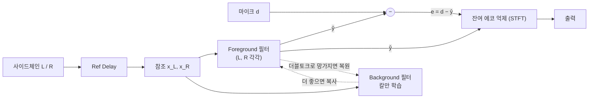
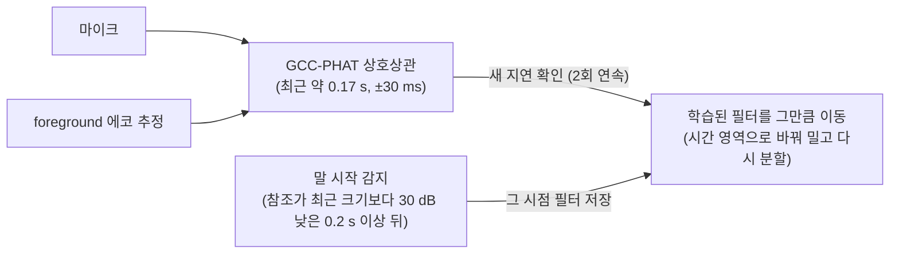

# DSP 설계

[[README|AbleAEC]]의 신호 처리 구조입니다. 코드는 `src/dsp/AecCore.cpp` 이며 JUCE에 의존하지 않아 [[build#테스트|오프라인 테스트]]와 [[realistic-test|실환경 시뮬레이션]]으로 단독 검증합니다.

## 전체 흐름



## 1. 선형 적응 필터 — GMDF (겹치는 분할 블록 주파수 영역 필터)

- **파티션 길이 L** (필터 FFT 크기 `N = 2L`) 이 주파수 분해능을, **hop B** 가 지연을 결정합니다. `B ≤ L` 이므로 두 값을 따로 고를 수 있습니다 (Moulines 외 1995, Generalised Multidelay Filter).
- 매 hop마다 최근 `N` 샘플의 참조 스펙트럼을 계산하고, 파티션 p 는 `p·L/B` hop 전의 스펙트럼을 사용합니다.

| Latency 모드 | hop B (48 kHz) | 파티션 L | 주파수 칸 간격 | 플러그인 지연 |
| --- | --- | --- | --- | --- |
| Quality (기본) | 512 | 2048 | 23 Hz | 1024 샘플 ≈ 21.3 ms |
| Low | 256 | 2048 | 23 Hz | 512 샘플 ≈ 10.7 ms |

88.2/96 kHz 에서는 모두 2배 (같은 시간 길이). 이전 버전은 B = L = 512 (분해능 47 Hz) 였고, EDM 서브베이스·피아노 순음에서 4–8 dB밖에 지우지 못했습니다 ([[realistic-test#개선 이력 (이 테스트로 찾은 문제)|개선 이력]]).

- 필터 파티션 수 `P = ceil(FilterLength × fs / L)` (48 kHz, 250 ms → 6 파티션)
- **참조 채널별 필터**: `Ŷ(k) = Σ_c Σ_p W_{c,p}(k) · X_{c,p}(k)` (c = L, R). 스피커 2대에서 마이크까지의 경로가 서로 다르므로 스테레오 참조가 기본 (`Reference: Mono (L+R)` 로 전환 가능)
- 시간 영역 인과성 제약(gradient constraint)은 hop마다 2개 파티션씩 순환 적용

## 2. 칼만 필터 학습 (background)

주파수 영역 칼만 필터를 대각 근사한 방식입니다 (Kuech, Mabande & Enzner 2014).

```
E(k)       = FFT([0 … 0, e])                 (최근 B 샘플의 오차, N점)
den(k)     = Σ_c Σ_p Pc_{c,p}(k) |X_{c,p}(k)|²  +  (N/B) · Ψ(k)
W_{c,p}   += 2μ · Pc_{c,p}(k) / den(k) · conj(X_{c,p}(k)) · E(k)
Pc_{c,p}   = A² · (1 − (B/N) · Pc |X|² / den) · Pc  +  (1 − A²)|W|²  +  q
Ψ(k)       = 0.5 Ψ(k) + 0.5 |E(k)|²        (관측 잡음 = 보컬 + 잡음 + 잔여)
```

- `Pc` (상태 불확실도)가 (채널, 파티션, 주파수)마다 따로 있음 → **처음 나타나는 주파수(새 코드, 새 악기)는 즉시 빠르게 학습**하고, 이미 배운 주파수는 안정적으로 유지
- 보컬이 크면 `Ψ` 가 커져 학습이 **자동으로 느려짐** (더블토크에 강함)
- `A = 0.999`, `q = 1e-8` (512 샘플 hop 기준, hop 길이에 맞춰 환산), `Pc` 초기값 1, `μ` = Adapt Speed (기본 0.5 → 이득 1)
- **에코 경로 변화 감지**: leakage `η > 0.5` (오차가 여전히 에코 추정과 강하게 상관 = 마이크/스피커 이동) **이고** foreground가 실제 에코를 추정하고 있을 때(에코 추정 ≥ 마이크의 -13 dB)만 `Pc` 를 키워 재학습. 에코가 마이크에 안 들어올 때(추정 ≈ 0)는 η 가 의미 없으므로 무시 — 이 조건이 없으면 목소리를 쫓아가 손상시킴 ([[realistic-test#해석|no_echo 시나리오]])

이전 버전(고정 스텝 NLMS)과 비교: [[realistic-test#개선 이력 (이 테스트로 찾은 문제)|개선 이력]]

## 3. 2-경로(foreground / background) 구조

출력은 항상 foreground 필터 결과를 쓰고, background(칼만 학습)는 아래 통계적 판정으로만 foreground가 됩니다 (Speex `mdf.c` 방식). 판정은 hop 길이와 상관없이 약 10.7 ms 단위로 에너지를 모아서 합니다.

```
Sf, Sb = foreground / background 오차 에너지,  Dbf = |ŷ_F − ŷ_B|² (두 필터 출력 차이)
diff = Sf − Sb   (양수 = background가 나음)
승격:  Sb < 0.9·Sf  그리고  diff·|diff| > 4·Sf·Dbf  (또는 평활 평균/분산 버전)
되돌림: −diff·|diff| > 64·Sf·Dbf  → background를 foreground로 복원
안전장치: foreground 오차 > 마이크 × 8 → 전체 초기화
```

- `Dbf` 는 "근단 소리 때문에 우연히 생길 수 있는 차이"의 크기 → 개선이 그보다 확실히 클 때만 승격
- 승격을 엄격하게(약 2σ + 0.5 dB) 하는 이유: 에코가 없거나 약하면 background는 목소리를 우연히 쫓아가는 것으로만 "나아질" 수 있음
- 되돌림은 느슨하게(64): 칼만 필터는 빠르게 배우는 동안 오차가 잠깐 커질 수 있음

## 4. 잔여 에코 억제 (RES)

- STFT (sqrt-Hann 창, 50 % 겹침, 2B점 — 필터와 별도)
- 잔여 에코 추정: `R(k) = 4·amount · max(η, 0.02) · |Ŷ(k)|²`
  - `η` (leakage): 오차 스펙트럼 변동과 에코 추정 스펙트럼 변동의 상관 (Valin 2007)
- 이득: `G(k) = max(floor, 1 − R / |E|²)`, 빠른 attack / 느린 release로 평활
- 기본값 amount 20 %, floor -18 dB ([[realistic-test#해석|보컬 보존과의 균형]])
- `amount = 0` 이거나 `Linear AEC only` 모드에서는 이득 1 (완전 복원 합성)

## 5. 에코 지연 추정

약 8192 샘플마다 foreground 필터(모든 참조 채널) 임펄스 응답의 최대 탭 위치를 찾아 `Echo delay` 로 표시합니다 (UI 값에는 Ref Delay가 더해짐).

## 6. 지연 점프 추종 (통화 앱)

디스코드 같은 통화 앱은 상대가 말을 멈추면 재생 스트림을 멈췄다가 다시 시작합니다. 이때 스피커로 나가는 소리와 사이드체인(참조) 사이의 시간이 몇 ms씩 바뀔 수 있습니다. 1 ms만 어긋나도 선형 필터는 거의 지우지 못하므로(시뮬레이션 0 dB), 예전에는 **상대가 말을 시작할 때마다 처음부터 다시 학습** 했습니다.



- 마이크와 **foreground 에코 추정** 의 상호상관(GCC-PHAT)을 구합니다. 필터가 맞으면 0에서, 지연이 바뀌었으면 바뀐 만큼에서 최고점이 나옵니다.
- 최고점이 ±2 샘플 이상 떨어져 있고, 일반 상관계수가 0.3 이상이며 현재 정렬보다 높고, PHAT 값이 현재 정렬의 1.5배 이상인 결과가 **두 번 연속** 같으면 지연이 바뀐 것으로 봅니다.
- 학습된 foreground / background 필터를 시간 영역 임펄스 응답으로 바꿔 그만큼 밀고 다시 파티션으로 나눕니다. 방 전체를 다시 배우지 않으므로 바로 원래 감쇄로 돌아갑니다.
- **말 시작 시점 저장:** 참조가 최근 크기보다 30 dB 이상 작은 상태가 0.2초 이상 이어진 뒤 다시 커지면, 그 순간의 필터 상태를 저장합니다. 0.6초 안에 지연 점프가 확인되면 그사이 어긋난 데이터로 학습한 것을 되돌린 뒤 이동합니다.
- 검사 주기: 말 시작 후 1초 동안은 약 43 ms마다, 그 뒤에는 약 0.34초마다. CPU 증가는 수 % 이내입니다.
- ±1 샘플 이하(분수 지연)는 적응 학습에 맡깁니다. 최고점이 흔들려 필터가 왔다 갔다 하는 것을 막기 위해서입니다.

효과는 [[realistic-test#통화 앱 테스트 (`run_voicechat.py`)|통화 앱 테스트]] 참고 (지연 점프가 있을 때 말 중간 감쇄 6.5 → 24.3 dB).

## 지연(latency) 구조

| 단계 | Quality (48 kHz) | Low (48 kHz) |
| --- | --- | --- |
| 플러그인 블록 FIFO (`PluginProcessor`) | 512 | 256 |
| AecCore 내부 잔여 억제 STFT 합성 (2B 프레임) | 512 | 256 |
| **합계 (호스트에 보고)** | **1024 샘플 ≈ 21.3 ms** | **512 샘플 ≈ 10.7 ms** |

- 필터 파티션(2048)은 과거 참조만 사용하므로 지연을 늘리지 않습니다.
- 모든 출력 모드가 같은 지연을 가지므로 전환해도 위상이 맞습니다 (`plugin_host_test` 검증).
- Latency 모드는 두 세트의 코어를 미리 준비해 두고 전환하므로 오디오 스레드에서 메모리 할당이 없습니다. 전환 시 필터는 초기화됩니다.
- 에코는 항상 참조보다 늦게 마이크에 도착하므로 인과적 필터로 모델링할 수 있습니다. 지연이 필터 길이에 비해 너무 크면 `Ref Delay` 로 참조를 늦춥니다.

## 채널 처리

- 참조: 스테레오 사이드체인이면 L/R 각각 (기본), 모노 사이드체인이거나 `Mono (L+R)` 선택 시 합산
- 마이크: 채널별 독립 처리. 모노 마이크를 스테레오 트랙에서 쓰는 경우(L == R) 한 번만 처리하고 복사

## CPU (48 kHz, 마이크 채널당, 단일 코어)

| 설정 | Filter 250 ms | Filter 500 ms |
| --- | --- | --- |
| Quality, 스테레오 참조 (기본) | 약 9 % | 약 10 % |
| Quality, 모노 참조 | 약 5.5 % | 약 6.6 % |
| Low, 스테레오 참조 | 약 16 % | 약 19 % |
| Low, 모노 참조 | 약 11 % | 약 12 % |

클라우드 Linux 컨테이너에서 측정한 값이라 실제 PC에서는 다를 수 있습니다. [[#6. 지연 점프 추종 (통화 앱)|지연 점프 추종]]이 더해져 위 값보다 0.5–1 %p 정도 늘 수 있습니다. 모노 마이크를 스테레오 트랙에서 쓰면(L == R) 한 번만 처리하므로 위 값 그대로입니다. 이전 버전(분해능 47 Hz) 대비 약 2배이며, 대신 서브베이스·순음 처리 능력이 크게 좋아졌습니다.

## 한계

- 스피커 왜곡 같은 비선형 에코는 RES로만 줄임 (선형 필터는 비선형 성분을 못 지움)
- 처음 학습에 반주 기준 수 초–20초 필요 ([[realistic-test#해석|해석]]). 통화처럼 상대 말소리만 있을 때는 상대가 5초 정도 말해야 15 dB (선형 기준, 잔여 억제를 더하면 2초)
- 지연 점프는 확인하는 데 약 0.1–0.2초가 걸려서, 점프 직후 말의 첫 0.5초는 덜 지워짐 (평균 약 10 dB)
- Low 모드는 피아노처럼 순음 위주인 음악에서 Quality보다 크게 약함
- 에코가 완전히 사라졌다 다시 나타나면 처음부터 다시 학습
- 잡음 제거(NS), 자동 이득(AGC), 컴포트 노이즈는 포함하지 않음
- 스피커와 마이크가 다른 클럭의 장치면 성능이 크게 저하됨 ([[ableton-setup#2. 플러그인 삽입과 사이드체인 연결|설정 가이드]] 참고)

## 관련 문서

- [[AbleAEC-MOC|문서 목차]]
- [[realistic-test|실환경 시뮬레이션 테스트]]
- [[ableton-setup|Ableton 설정 가이드]]
- [[build|빌드 및 설치]]
