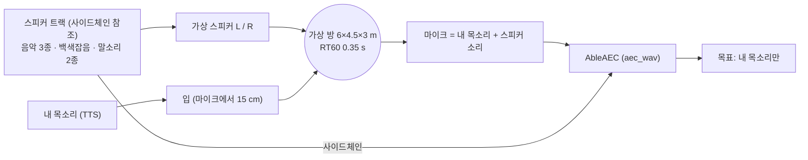

# 실환경 시뮬레이션 테스트

실제 Ableton Live 없이 [[dsp-design|AEC 알고리즘]]을 실제 사용 상황에 가깝게 검증하는 테스트입니다.
스크립트: `tests/realistic/run_realistic.py`, 처리 도구: `tools/aec_wav.cpp`

## 테스트하는 상황



| 구분 | 내용 |
| --- | --- |
| 마이크 입력 | 내 목소리 + 스피커 소리(방 반사 포함) + 마이크 잡음 |
| 스피커 트랙 (= 사이드체인) | 아래 6종 중 하나 |
| 기대 결과 | 내 목소리만 남음 |
| 시간 구성 (30초) | 0–8초 스피커만 → 8–20초 목소리 + 스피커 → 20–30초 스피커만 |
| 오디오 인터페이스 지연 | 572 샘플 (스피커 출력 + 마이크 입력) |

### 스피커 소리 6종

| 이름 | 내용 | 어려운 점 |
| --- | --- | --- |
| `music_pop` | 드럼·베이스·패드·아르페지오, 120 BPM, 넓은 스테레오 | 일반적인 반주 |
| `music_piano` | 피아노 발라드, 76 BPM, 음높이별 패닝 | 순음 위주, 쉬는 구간 많음 |
| `music_edm` | 4비트 킥, 서브베이스, 펌핑 신스, 마스터링(소프트 클립) | 저역 에너지 큼, 음압 큼 |
| `white_noise` | L/R 서로 다른 백색잡음 | 가장 쉬운 신호 (기준) |
| `speech_mono` | 원격 화자 1명, 남녀 4가지 목소리, 한국어·영어, L = R | 내 목소리와 같은 종류의 소리 |
| `speech_two` | 원격 화자 2명이 L / R에서 번갈아 말함 | 화자 전환마다 다른 경로 |

### 조건

| 조건 | 내용 |
| --- | --- |
| `stereo` | 스피커 2대, 스피커 소리 = 목소리와 같은 크기 |
| `mono_speaker` | 스피커 1대 |
| `distortion_noise` | 스피커 왜곡(tanh) + 마이크 잡음 -60 dB |
| `loud_bleed` | 스피커 소리가 목소리보다 6 dB 큼 |
| `weak_echo` | 스피커가 멀어서 스피커 소리가 목소리보다 20 dB 작음 |
| `no_echo` | 스피커 소리가 마이크에 전혀 안 들어감 (사이드체인만 있음) |
| `echo_on_off` | 스피커 소리가 0–5, 10–14, 22–26초에만 들림 (움직임·인식 범위 이탈) |

### 지표

- **ERLE**: 스피커 소리가 얼마나 줄었는지 (클수록 좋음). 말소리 쉬는 구간처럼 에코가 없는 곳은 계산에서 뺌
- **보컬 SER**: 출력이 원래 목소리와 얼마나 같은지 (클수록 좋음). 처리 전 → 처리 후
- **15 dB 도달 시간**: 처음 0–8초 동안 0.5초 단위 ERLE가 15 dB에 처음 도달한 시간

## 결과 (기본값: Quality 모드, 스테레오 참조, Filter 300 ms)

Linear = 선형 필터만, Clean = 잔여 억제 포함 (플러그인 기본 출력)

| 시나리오 | ERLE 스피커만 4–8 s (Linear) | ERLE 목소리 후 23–30 s (Linear / Clean) | 보컬 SER 처리 전 → Linear / Clean | 15 dB 도달 (Linear / Clean) |
| --- | --- | --- | --- | --- |
| music_pop · stereo | 14.7 | 27.1 / 39.5 | 5.9 → **25.7** / 15.1 | 6.0 / 2.0 s |
| music_pop · mono_speaker | 20.7 | 28.7 / 41.2 | 5.2 → **28.9** / 15.2 | 3.5 / 2.0 s |
| music_pop · distortion_noise | 13.7 | 17.8 / 23.3 | 5.9 → **23.2** / 15.9 | 7.0 / 4.0 s |
| music_pop · loud_bleed | 12.4 | 27.8 / 41.6 | -0.1 → **20.0** / 13.1 | 7.0 / 4.5 s |
| music_piano · stereo | 8.8 | 17.5 / 21.4 | 5.6 → **15.9** / 12.0 | 7.5 / 3.0 s |
| music_edm · stereo | 10.3 | 26.7 / 38.8 | 5.6 → **20.3** / 15.5 | – / 4.0 s |
| music_edm · loud_bleed | 11.2 | 29.0 / 41.8 | -0.4 → **15.1** / 13.7 | 5.5 / 3.0 s |
| white_noise · stereo | 26.0 | 33.9 / 48.2 | 5.6 → **30.7** / 12.8 | 3.0 / 2.0 s |
| white_noise · distortion_noise | 19.8 | 21.0 / 31.0 | 5.6 → **25.6** / 13.2 | 3.5 / 2.0 s |
| speech_mono · stereo | 17.6 | 25.3 / 31.9 | 5.2 → 12.5 / 11.9 | 4.5 / 2.0 s |
| speech_mono · mono_speaker | 19.3 | 24.8 / 33.4 | 4.9 → 12.9 / 11.5 | 4.0 / 2.5 s |
| speech_two · stereo | 4.4 | 20.2 / 26.8 | 6.0 → 8.7 / 8.6 | – / 2.0 s |
| music_pop · weak_echo (-20 dB) | 13.1 | 16.0 / 17.9 | 25.8 → 20.4 / 18.0 | 6.5 / 5.5 s |
| music_pop · **no_echo** | – | – | 46.3 → **46.3 / 46.3** (변화 없음) | – |
| music_pop · echo_on_off | 10.6 | 5.3 / 10.0 | 10.5 → 11.0 / 10.9 | – / 4.0 s |
| speech_mono · weak_echo (-20 dB) | 9.0 | 14.4 / 17.0 | 25.2 → 18.1 / 16.5 | – |
| speech_mono · **no_echo** | – | – | 46.3 → **46.3 / 46.3** (변화 없음) | – |

![[audio/spectrogram_grid.jpg]]

### Low 모드 (지연 약 11 ms)

음악·말소리 대부분은 Quality와 1–3 dB 차이이지만, **피아노처럼 순음 위주인 음악은 크게 약합니다** (목소리 후 ERLE 약 7–12 dB). 에코가 없을 때 목소리를 건드리지 않는 것은 Low 모드에서도 동일합니다.

## 자동(Auto) 모드 비교

`run_realistic.py ... --auto` 로 같은 시나리오를 자동 모드로 돌립니다. 방 크기 시나리오 `music_pop · reverb_room` (RT60 0.8 s), `music_pop · dry_room` (RT60 0.15 s) 이 추가되어 있습니다. 결과 요약은 [[user-manual#6-1. 자동(Auto) 모드|사용 설명서]] 참고 (울림이 긴 방 60초 실행 9.6 → 18.1 dB, 나머지는 대부분 ±0.5 dB). CI는 자동 모드에서도 에코 없음·약한 에코·기본 시나리오 기준치를 검사합니다.

설계하면서 확인한 것: 필터를 자동으로 **줄이는** 규칙은 CPU 절약이 작고 EDM에서 3 dB 손해가 나서 넣지 않았고, 노래 중 잔여 억제를 "최근 최고 감쇄"로 정하는 규칙은 노래할수록 억제가 세져 목소리를 손상시켜서 "마이크 속 에코 비중" 기준으로 바꿨습니다.

## 해석

- **잘 되는 것**: 팝·EDM·백색잡음·말소리 모두 목소리 후 20–34 dB (Clean 27–48 dB). 노래하는 동안에도 필터가 망가지지 않고 계속 학습합니다.
- **스피커 소리가 안 들어올 때**: 사이드체인에 소리가 있어도 마이크에 에코가 없으면 **출력 = 원래 마이크** 입니다 (보컬 SER 46.3 dB 그대로).
- **스피커 소리가 약할 때 (-20 dB)**: 약 15–20 dB 더 줄입니다. 다만 원래도 목소리가 충분히 깨끗한 상황이라, 보컬 SER은 25 → 18–20 dB로 약간 손해를 봅니다. 이 경우 AEC를 끄거나 Residual Supp.를 0으로 두어도 됩니다.
- **학습 시간**: 처음 15 dB까지 Clean 기준 2–5초, Linear 기준 4–8초. 노래 전에 스피커 소리를 10–20초 먼저 틀어두면 좋습니다.
- **어려운 경우**
  - 피아노 발라드: 순음과 긴 여운 → 17.5 dB
  - 원격 말소리 위에서 말하기: 지울 소리와 남길 소리가 둘 다 사람 목소리라 보컬 SER 9–13 dB
  - 에코가 완전히 사라졌다 다시 나타남: 사라지는 순간 필터가 초기화되고, 다시 나타나면 처음부터 배워야 해서 4초 안에는 5–10 dB. 스피커·마이크 위치가 그대로면 이런 일은 드뭅니다.
- **Linear vs Clean**: Clean(잔여 억제)은 스피커 소리를 6–14 dB 더 지우지만 목소리 파형도 약간 바꿉니다. SER 지표는 작은 이득 변화도 크게 감점하므로 청감상 차이보다 엄격합니다.

## 개선 이력 (이 테스트로 찾은 문제)

| 문제 | 원인 | 조치 |
| --- | --- | --- |
| 음악에서 수렴 느림 | 고정 스텝 NLMS | 주파수 영역 칼만 필터 |
| 스테레오 스피커 약 5 dB | L+R 모노 합산 참조 | 스테레오(2채널) 참조 |
| EDM 4.6 dB, 피아노 8 dB | FFT 분해능 47 Hz → 서브베이스·순음 처리 불가 | GMDF: 파티션 2048 (분해능 23 Hz), 지연은 hop으로 유지 |
| 노래 중 필터가 잘못 바뀜 | 단순한 foreground/background 판정 | Speex 방식 통계적 판정, 10.7 ms 단위로 모아서 판정 |
| **에코가 없을 때 목소리 손상** (46 → 14 dB) | 에코 추정이 0일 때 경로 변화 감지가 오작동, 우연한 승격 | 경로 변화 감지는 실제 에코가 추정될 때만, 승격은 약 2σ + 0.5 dB 이상 개선 시에만 |
| 칼만 도입 후 에코 경로 변화 추종 느림 | 수렴 후 불확실도가 작아짐 | 상태전이 0.999 + leakage 기반 경로 변화 감지 |
| Clean 모드가 보컬 손상 | 잔여 억제 기본값 과함 | 50 %/-30 dB → 20 %/-18 dB |

## 들어보기

`docs/audio/` (모두 30초, 0–8초 스피커만 · 8–20초 목소리 + 스피커 · 20–30초 스피커만)

| 파일 | 내용 |
| --- | --- |
| `vocal_only_reference.mp3` | 정답: 내 목소리만 |
| `speaker_music_pop.mp3`, `speaker_music_piano.mp3`, `speaker_music_edm.mp3`, `speaker_speech_two.mp3` | 스피커 트랙 (사이드체인으로 들어가는 소리) |
| `<시나리오>_1_mic.mp3` | 처리 전 마이크 |
| `<시나리오>_2_after.mp3` | AbleAEC 처리 후 (Clean, 기본 설정) |

시나리오: `music_pop_stereo`, `music_piano_stereo`, `music_edm_stereo`, `white_noise_stereo`, `speech_mono_stereo`, `speech_two_stereo`, `music_pop_weak_echo`, `music_pop_no_echo`

## 직접 실행하기

```bash
sudo apt-get install -y espeak-ng
python3 -m pip install numpy scipy
cmake -S . -B build -G Ninja -DCMAKE_BUILD_TYPE=Release -DABLEAEC_BUILD_PLUGIN=OFF
cmake --build build
python3 tests/realistic/run_realistic.py --check build/aec_wav build/realistic      # 전체 17개 + 기준치 검사
python3 tests/realistic/run_realistic.py build/aec_wav build/realistic_low --latency low
python3 tests/realistic/run_realistic.py --only music_edm,speech_mono build/aec_wav build/subset
```

`--check` 는 회귀 기준치(20개 항목) 미달 시 실패하며, CI(Linux)에서 매번 실행됩니다.

### 내 녹음으로 확인하기 (`aec_wav`)

Ableton에서 **스피커 트랙** 과 **AEC 없이 녹음한 마이크 트랙** 을 같은 길이·샘플레이트로 WAV로 내보낸 뒤:

```bash
build/aec_wav speaker.wav mic_raw.wav mic_aec.wav                      # 기본 (Quality, 스테레오 참조, Clean)
build/aec_wav speaker.wav mic_raw.wav mic_aec_lin.wav --mode linear --filter 400
build/aec_wav speaker.wav mic_raw.wav mic_aec_low.wav --latency low
```

결과 파일은 마이크와 시간이 정렬되어 있습니다.

## 한계

- TTS 목소리와 합성 음원이며, 실제 노래(비브라토·고음)와 실제 믹스·녹음과는 다릅니다.
- 방 응답은 직육면체 이미지 소스 모델이고, 실제 스피커의 저역 롤오프·지향성·비선형 특성은 단순화되어 있습니다.
- SER은 파형 기준 지표라 청감상 차이보다 엄격합니다.

## 관련 문서

- [[AbleAEC-MOC|문서 목차]]
- [[dsp-design|DSP 설계]]
- [[ableton-setup|Ableton 설정 가이드]]
- [[build|빌드 및 설치]]
