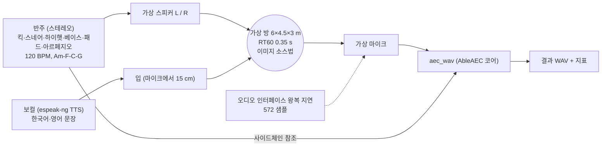

# 보컬 + 반주 실환경 시뮬레이션 테스트

실제 Ableton Live 없이 [[dsp-design|AEC 알고리즘]]을 실제 사용 상황에 가깝게 검증하는 테스트입니다.
스크립트: `tests/realistic/run_realistic.py`, 처리 도구: `tools/aec_wav.cpp`

## 시나리오 구성



- 0–8 초: 반주만 (학습 구간) → **ERLE music-only** 는 4–8 초 측정
- 8–20 초: 반주 위에 노래 (더블토크) → **vocal SER** (보컬이 얼마나 깨끗한가)
- 20–30 초: 반주만 → **ERLE after double-talk** 는 23–30 초 측정 (노래 중에 필터가 망가지지 않았는지)

| 시나리오 | 내용 |
| --- | --- |
| 1_mono_speaker | 스피커 1대 (반주를 모노로 재생) |
| 2_stereo_speakers | 스피커 2대, L/R 다른 소리 (가장 일반적인 홈스튜디오) |
| 3_stereo_distortion_noise | 2 + 스피커 왜곡 (tanh) + 마이크 잡음 -60 dB |
| 4_stereo_loud_bleed | 2 + 반주 번짐이 보컬보다 6 dB 큼 |

지표: ERLE = 마이크 대비 출력 감쇄량 (클수록 반주 제거 잘 됨), SER = 보컬 대 (보컬 이외 모든 것) 비 (클수록 출력이 원래 보컬에 가까움).

## 결과 (기본 설정: Quality 모드, 스테레오 참조, Filter 300 ms)

| 시나리오 | 모드 | ERLE 반주만 (4–8 s) | ERLE 노래 후 (23–30 s) | 보컬 SER 처리 전 → 후 |
| --- | --- | --- | --- | --- |
| 1 스피커 1대 | Linear | 19.1 dB | 26.9 dB | 5.2 → **26.6 dB** |
| | Clean | 26.1 dB | 38.4 dB | 5.2 → 15.6 dB |
| 2 스테레오 스피커 | Linear | 8.0 dB | 20.9 dB | 5.9 → **19.2 dB** |
| | Clean | 14.5 dB | 27.2 dB | 5.9 → 15.4 dB |
| 3 + 왜곡·잡음 | Linear | 10.8 dB | 16.5 dB | 5.9 → 19.0 dB |
| | Clean | 15.9 dB | 21.9 dB | 5.9 → 15.8 dB |
| 4 반주 번짐 큼 | Linear | 9.7 dB | 22.0 dB | -0.1 → **16.1 dB** |
| | Clean | 16.1 dB | 28.4 dB | -0.1 → 13.0 dB |

![[audio/stereo_spectrogram.jpg]]

### 들어보기 (시나리오 2, 4)

| 파일 | 내용 |
| --- | --- |
| `audio/backing_track.mp3` | 스피커로 나간 반주 (= 사이드체인 참조) |
| `audio/stereo_1_mic_before.mp3` | 마이크 원본 (보컬 + 반주 번짐) |
| `audio/stereo_2_after_aec.mp3` | AbleAEC 처리 후 (Clean) |
| `audio/stereo_3_vocal_only_reference.mp3` | 정답 (보컬만) |
| `audio/loud_*.mp3` | 시나리오 4 (반주 번짐이 6 dB 큰 경우) 같은 구성 |

## 해석

- **학습 시간**: 반주만 나올 때 처음 몇 초는 감쇄가 작고(스테레오 4–8 초 약 8–15 dB), 20초 전후에 20 dB 이상으로 수렴합니다. 실사용에서는 **노래 시작 전 반주를 10–20초 먼저 재생**하면 좋습니다.
- **노래 중 안정성**: 칼만 필터 + 2-경로 구조 덕분에 노래하는 동안 필터가 망가지지 않고, 노래 후 감쇄가 오히려 더 높습니다 (계속 학습).
- **Linear vs Clean**: Clean(잔여 억제)은 반주를 6–10 dB 더 지우지만 보컬 파형도 약간 바꿉니다 (SER 3–11 dB 손해). 녹음 품질이 중요하면 Residual Supp.를 낮추고, 반주가 남는 게 더 싫으면 올리세요.
- **Low latency 모드 (블록 256)**: 음악에서는 성능이 크게 떨어집니다 (스테레오 시나리오 ERLE 노래 후 5–10 dB). 주파수 분해능(94 Hz)이 부족해 킥·베이스 저역을 다루지 못하기 때문입니다. 음성·모노 위주일 때만 권장합니다.
- **모노 합산 참조와 비교**: L/R이 다른 반주에서 스테레오 참조가 항상 같거나 낫습니다 (시나리오 4 보컬 SER 10.5 → 16.1 dB). L/R이 완전히 다른 극단적 경우 플러그인 호스트 테스트에서 64 dB vs 6 dB.

## 개선 이력 (이 테스트로 찾은 문제)

| 문제 | 원인 | 조치 |
| --- | --- | --- |
| 음악에서 수렴 느림 (스피커 1대도 ~10 dB) | 고정 스텝 NLMS, 512점 FFT의 저역 분해능 부족 | 주파수 영역 칼만 필터 + Quality 모드 블록 512 |
| 스테레오 스피커 ~5 dB | L+R 모노 합산 참조로는 두 경로를 모델링 불가 | 스테레오(2채널) 참조 필터 |
| 칼만 도입 후 에코 경로 변화 추종 느림 | 수렴 후 불확실도가 작아짐 | 상태전이 0.999 + leakage 기반 경로 변화 감지 |
| Clean 모드가 보컬 손상 | 잔여 억제 기본값 과함 | 기본값 50 %/-30 dB → 20 %/-18 dB |

## 직접 실행하기

```bash
sudo apt-get install -y espeak-ng
python3 -m pip install numpy scipy
cmake -S . -B build -G Ninja -DCMAKE_BUILD_TYPE=Release -DABLEAEC_BUILD_PLUGIN=OFF
cmake --build build
python3 tests/realistic/run_realistic.py --check build/aec_wav build/realistic
# 저지연 모드 / 모노 참조 비교
python3 tests/realistic/run_realistic.py build/aec_wav build/realistic_low --latency low
python3 tests/realistic/run_realistic.py build/aec_wav build/realistic_mono --monoref
```

`--check` 는 회귀 기준치 미달 시 실패하며, CI(Linux)에서 매번 실행됩니다.

### 내 녹음으로 확인하기 (`aec_wav`)

Ableton에서 **스피커 트랙(반주)** 과 **AEC 없이 녹음한 마이크 트랙** 을 같은 길이로 WAV로 내보낸 뒤:

```bash
build/aec_wav backing.wav mic_raw.wav mic_aec.wav            # 기본 (Quality, 스테레오 참조)
build/aec_wav backing.wav mic_raw.wav mic_aec_lin.wav --mode linear --filter 400
```

두 파일의 샘플레이트가 같아야 합니다. 결과 파일은 마이크와 시간이 정렬되어 있습니다.

## 한계

- TTS 보컬과 합성 반주이며, 실제 노래(비브라토·고음)와 실제 믹스와는 다릅니다.
- 방 응답은 직육면체 이미지 소스 모델이고, 실제 스피커의 저역 롤오프·지향성·비선형 특성은 단순화되어 있습니다.
- 지표 SER은 파형 기준이라 잔여 억제의 작은 이득 변화도 크게 감점합니다 (청감상 차이보다 엄격).

## 관련 문서

- [[AbleAEC-MOC|문서 목차]]
- [[dsp-design|DSP 설계]]
- [[ableton-setup|Ableton 설정 가이드]]
- [[build|빌드 및 설치]]
