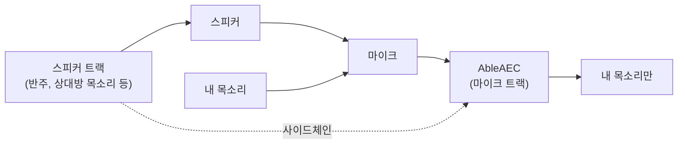

# AbleAEC 사용 설명서

에이블톤 라이브(Ableton Live)에서 **마이크에 들어간 스피커 소리(에코)를 지우고 내 목소리만 남기는** 플러그인입니다.
같은 내용이 플러그인 안의 **설명서** 버튼에도 들어 있습니다.

![[plugin-ui-ko.png]]

## 1. 이 플러그인이 하는 일

마이크에는 내 목소리와 스피커에서 나온 소리가 함께 들어갑니다. AbleAEC는 사이드체인으로 받은 스피커 소리를 기준으로, 마이크에 다시 들어온 스피커 소리를 지웁니다.

## 2. 설치

1. GitHub Actions 결과물(`AbleAEC-windows`, `AbleAEC-macos`)을 내려받거나 [[build|직접 빌드]]합니다.
2. 플러그인 파일을 복사합니다.
   - Windows: `AbleAEC.vst3` → `C:\Program Files\Common Files\VST3\`
   - macOS: `AbleAEC.vst3` → `~/Library/Audio/Plug-Ins/VST3/`, `AbleAEC.component` → `~/Library/Audio/Plug-Ins/Components/`
   - macOS는 받은 파일의 격리 속성을 지웁니다: `xattr -dr com.apple.quarantine <파일>`
3. Live `Preferences → Plug-ins` 에서 **Use VST3 Plug-in System Folders** 를 켜고 **Rescan** 합니다.

## 3. 연결하기

1. AbleAEC를 **마이크 트랙**에 넣습니다. 마이크 트랙의 `Monitor` 는 **In** 으로 둡니다.
2. 디바이스 제목줄의 **펼치기 버튼**을 눌러 **Sidechain** 을 켭니다.
3. `Audio From` = **스피커로 나가는 트랙**, 탭 위치 = **Post Mixer** 로 지정합니다.
4. 오른쪽 아래 상태의 **사이드체인** 이 `수신 중` 이 되면 연결된 것입니다.

> [!warning] 주의
> - **Master를 사이드체인으로 쓰지 마세요.** 마이크가 Master로 가면 내 목소리까지 지우려 합니다. 스피커 소리가 여러 트랙이면 그룹이나 리턴 트랙으로 묶어서 지정하세요.
> - **스피커와 마이크는 같은 오디오 인터페이스**를 쓰세요. 장치가 다르면 시간이 어긋나 잘 지워지지 않습니다.

## 4. 쓰는 순서

1. 노래하기 전에 스피커 소리를 **10–20초 먼저** 틀어 두세요. 필터가 방의 울림을 배우는 시간입니다.
2. 상태가 `학습 완료` 가 되고 **에코 감쇄가 15 dB 이상**이면 녹음을 시작해도 좋습니다.
3. 노래하는 동안에도 필터는 망가지지 않고 계속 배웁니다.
4. 스피커 소리가 마이크에 안 들어가면(스피커가 멀거나 마이크 인식 범위 밖) 목소리를 건드리지 않습니다.
5. 마이크나 스피커 위치를 크게 바꾸면 **필터 초기화** 를 누르세요.

## 5. 화면 구성

| 위치 | 항목 | 설명 |
| --- | --- | --- |
| 오른쪽 위 | 언어 | `English` / `한국어`. 프로젝트에 저장되고, 처음에는 시스템 언어를 따릅니다 |
| 오른쪽 위 | 설명서 | 플러그인 안에서 이 설명서를 엽니다 |
| 위쪽 다이얼 | 조절기 5개 | 아래 6장 참고. 마우스를 올리면 설명(역할·비용)이 나옵니다 |
| 가운데 | 출력 / 지연 모드 / 참조 | 아래 6장 참고 |
| 왼쪽 아래 | 미터 | 스피커(사이드체인), 마이크 입력, 출력 크기 |
| 오른쪽 아래 | 상태 | 사이드체인, 에코 감쇄, 에코 지연, 상태, 지연 |

![[plugin-ui-guide-ko.png]]

## 6. 조절기: 역할과 비용

비용은 세 가지로 봅니다.
- **CPU:** 마이크 채널당 코어 1개 대비 사용률입니다. 기본 설정(품질 우선, 스테레오, 250 ms, 깨끗하게)은 약 **8 %**입니다. 클라우드 Linux에서 측정해서 실제 PC와 다를 수 있습니다.
- **지연:** 플러그인이 소리를 늦추는 정도입니다. **바뀌는 것은 지연 모드뿐**이고, 나머지 조절기는 지연을 바꾸지 않습니다.
- **부작용:** 음질이나 성능의 손해입니다.

| 한국어 화면 | 영어 화면 | 기본값 | 역할 | CPU | 지연 | 부작용·주의 |
| --- | --- | --- | --- | --- | --- | --- |
| 필터 길이 | Filter Length | 250 ms | 지울 수 있는 에코의 길이 (스피커→마이크 지연 + 방 울림). 넓거나 울리는 방은 300–500 ms | 50 ms 6.8 % · 100 ms 7.0 % · 250 ms 8.0 % · 500 ms 10.1 % | 변화 없음 | 짧으면 울림 끝부분이 남음. 길면 처음 학습이 조금 느림 |
| 학습 속도 | Adapt Speed | 50 % | 필터가 배우는 속도 | 변화 없음 | 변화 없음 | 높이면 노래할 때 흔들림 증가, 낮추면 수렴·추종이 느림 |
| 참조 지연 | Ref Delay | 0 ms | 스피커 신호를 미리 늦춤. 블루투스 스피커처럼 지연이 아주 클 때만 | 변화 없음 | 출력 지연은 늘지 않음 | 실제 에코 지연보다 크게 잡으면 에코를 못 지움 |
| 잔여 억제 | Residual Supp. | 20 % | 필터가 못 지운 나머지를 추가로 줄임 | 약 0.4 % (꺼도 7.9 %) | 변화 없음 | 높이면 반주는 더 줄지만 노래할 때 목소리가 약간 뭉개짐 |
| 억제 한계 | Supp. Floor | -18 dB | 잔여 억제가 한 주파수를 최대로 줄이는 양 | 변화 없음 | 변화 없음 | 낮출수록 더 지우지만 목소리 손상 가능성 증가 |
| 출력 | Output | 깨끗하게 | 깨끗하게(권장) / 선형 AEC만 / 추정 에코 듣기 / 원본 마이크 | 거의 같음 | **모두 같음** (바꿔도 박자 안 어긋남) | 추정 에코 듣기·원본 마이크는 확인용 |
| 지연 모드 | Latency | 품질 우선 | 처리 단위 크기 | 품질 우선 8 % · 저지연 **약 15 %** | 품질 우선 **1024 샘플 (≈21 ms)** · 저지연 **512 샘플 (≈11 ms)** | 저지연은 피아노류 음악에서 약함. 바꾸면 필터 초기화 |
| 참조 | Reference | 스테레오 | 스피커 신호를 L/R 따로 쓸지, 합칠지 | 스테레오 8 % · 모노 **5.2 %** | 변화 없음 | 스피커 2대에 모노를 쓰면 에코가 덜 지워짐 |
| 학습 멈춤 | Freeze | 꺼짐 | 지금 필터를 유지 | **4.1 %** (절반) | 변화 없음 | 마이크·스피커가 움직이면 따라가지 못함 |
| AEC 끄기 | AEC Off | 꺼짐 | 처리 없이 원본 출력 | 계산은 계속함 (바로 다시 켤 수 있게) | 변화 없음 (같은 지연 유지) | — |
| 필터 초기화 | Reset Filter | — | 학습 내용 지우기 | — | — | 다시 배우는 몇 초 동안 에코가 남음 |

플러그인 안 **설명서** 에도 같은 내용이 들어 있습니다.

![[plugin-ui-guide-cost-ko.png]]

조합 예시 (마이크 채널당 CPU):

| 설정 | CPU | 지연 |
| --- | --- | --- |
| 품질 우선 · 스테레오 · 250 ms (기본) | 약 8 % | 21.3 ms |
| 품질 우선 · 모노 · 250 ms | 약 5 % | 21.3 ms |
| 품질 우선 · 스테레오 · 500 ms | 약 10 % | 21.3 ms |
| 저지연 · 스테레오 · 250 ms | 약 15 % | 10.7 ms |
| 저지연 · 모노 · 250 ms | 약 10 % | 10.7 ms |

모노 마이크를 스테레오 트랙에서 쓰면(L == R) 한 번만 계산해서 위 값 그대로입니다. 진짜 스테레오 마이크면 2배입니다.

## 7. GPU를 쓰나요?

**아니요. GPU 기능은 없고, 필요하지도 않습니다.**

| 질문 | 답 |
| --- | --- |
| "학습"이 딥러닝인가요? | 아닙니다. 방의 반향(스피커→마이크 경로)을 실시간으로 따라가는 **적응 필터**입니다. 미리 학습된 신경망 모델이 없고, 연주하는 동안 계속 조금씩 고쳐 나가는 계산입니다 |
| 계산량은? | 기본 설정에서 CPU 한 코어의 약 8 %. GPU로 옮길 만큼 크지 않습니다 |
| GPU를 쓰면 빨라지나요? | 오히려 느려집니다. 5–10 ms마다 결과를 바로 내야 하는데, 오디오를 GPU로 보내고 받는 시간과 GPU 작업 대기 시간이 계산 자체보다 길고 들쭉날쭉합니다. 오디오가 끊기는 원인이 됩니다 |
| 언제 GPU가 의미 있나요? | 큰 신경망으로 잔여 에코를 지우는 방식(딥러닝 AEC)을 넣을 때입니다. 그런 모델도 실시간 오디오용은 보통 CPU에서 돌립니다. 현재 버전에는 없습니다 |

## 8. 화면 읽기

| 항목 | 뜻 |
| --- | --- |
| 사이드체인 | `연결 안 됨` / `연결됨, 신호 없음` / `수신 중 (스테레오)` / `수신 중 (모노)` |
| 에코 감쇄 | 스피커 소리만 날 때 마이크보다 출력이 얼마나 작아졌는지. 15 dB 이상 양호, 25 dB 이상 매우 좋음. 노래할 때 낮게 보이는 것은 정상 |
| 에코 지연 | 스피커에서 마이크까지 걸리는 시간 추정값 |
| 상태 | `스피커 신호 대기 중` / `학습 중...` / `학습 완료` |
| 지연 | 이 플러그인이 더하는 지연 (품질 우선 1024 샘플 ≈ 21 ms). 녹음은 Live가 자동으로 맞춰 줌 |

## 9. 문제 해결

| 증상 | 해결 |
| --- | --- |
| 사이드체인 `연결 안 됨` | 디바이스를 펼쳐 Sidechain을 켜고 Audio From을 지정 |
| `연결됨, 신호 없음` | 스피커 트랙이 재생 중인지, 페이더가 내려가 있지 않은지 확인 |
| 에코 감쇄가 계속 낮음 | 지연 모드가 품질 우선인지, 참조가 스테레오인지 확인하고 필터 길이를 늘려 보기. 스피커/마이크가 다른 장치인지 확인 |
| 목소리가 뭉개짐 | 잔여 억제를 낮추거나 억제 한계를 -12 dB 정도로 올리기 |
| 반주가 조금 남음 | 잔여 억제를 올리기. 스피커 볼륨이 너무 커서 찌그러지면 볼륨 낮추기 |
| 모니터링이 늦게 들림 | 오디오 인터페이스의 다이렉트 모니터링 사용, 또는 저지연 모드 |
| 한글이 깨져 보임 | 플러그인에 한글 글꼴이 들어 있어 보통 발생하지 않음. 발생하면 언어를 English로 바꾸고 알려 주세요 |

## 10. 성능 참고

가상 방 시뮬레이션 기준, 노래가 끝난 뒤 스피커 소리 감쇄(깨끗하게 출력): 팝 39.5 dB, EDM 38.8 dB, 피아노 21.4 dB, 백색잡음 48.2 dB, 말소리 31.9 dB. 자세한 내용은 [[realistic-test|실환경 시뮬레이션 테스트]] 참고. 실제 방과 실제 스피커에서는 이보다 낮을 수 있습니다.

## 관련 문서

- [[AbleAEC-MOC|문서 목차]]
- [[ableton-setup|Ableton Live 설정 가이드]] (자세한 설정)
- [[realistic-test|실환경 시뮬레이션 테스트]]
- [[dsp-design|DSP 설계]]
- [[build|빌드 및 설치]]
