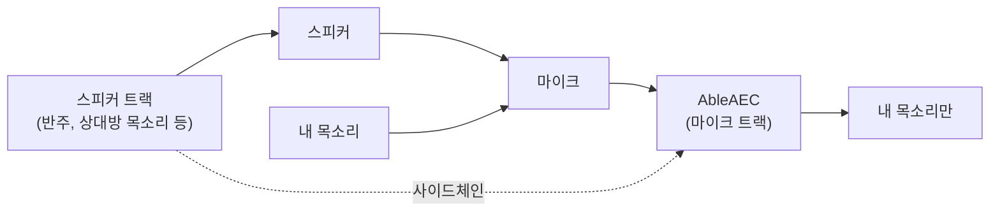
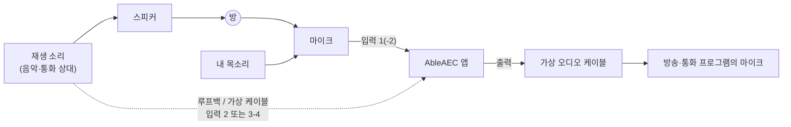

# AbleAEC 사용 설명서

에이블톤 라이브(Ableton Live)에서 **마이크에 들어간 스피커 소리(에코)를 지우고 내 목소리만 남기는** 플러그인입니다.
같은 내용이 플러그인 안의 **설명서** 버튼에도 들어 있습니다.

![[plugin-ui-ko.png]]

## 1. 이 플러그인이 하는 일

마이크에는 내 목소리와 스피커에서 나온 소리가 함께 들어갑니다. AbleAEC는 사이드체인으로 받은 스피커 소리를 기준으로, 마이크에 다시 들어온 스피커 소리를 지웁니다.

## 2. 설치

1. GitHub Actions 결과물(`AbleAEC-windows`, `AbleAEC-macos`)을 내려받거나 [[build|직접 빌드]]합니다. 플러그인과 함께 `App` 폴더에 독립 실행 앱이 들어 있습니다 (앱은 아무 위치에 두고 실행).
2. 플러그인 파일을 복사합니다.
   - Windows: `AbleAEC.vst3` → `C:\Program Files\Common Files\VST3\`
   - macOS: `AbleAEC.vst3` → `~/Library/Audio/Plug-Ins/VST3/`, `AbleAEC.component` → `~/Library/Audio/Plug-Ins/Components/`
   - macOS는 받은 파일의 격리 속성을 지웁니다: `xattr -dr com.apple.quarantine <파일>`
3. Live `Preferences → Plug-ins` 에서 **Use VST3 Plug-in System Folders** 를 켜고 **Rescan** 합니다.

## 3. 연결하기

1. AbleAEC를 **마이크 트랙**에 넣습니다. 마이크 트랙의 `Monitor` 는 **In** 으로 둡니다.
2. 디바이스 제목줄의 **펼치기 버튼**을 눌러 **Sidechain** 을 켭니다.
3. `Audio From` = **스피커로 나가는 트랙**, 탭 위치 = **Post Mixer** 로 지정합니다.
4. 오른쪽 아래 상태의 **사이드체인** 이 `수신 중` 이 되면 연결된 것입니다.

> [!warning] 주의
> - **Master를 사이드체인으로 쓰지 마세요.** 마이크가 Master로 가면 내 목소리까지 지우려 합니다. 스피커 소리가 여러 트랙이면 그룹이나 리턴 트랙으로 묶어서 지정하세요.
> - **스피커와 마이크는 같은 오디오 인터페이스**를 쓰세요. 장치가 다르면 시간이 어긋나 잘 지워지지 않습니다.

## 4. 쓰는 순서

1. 노래하기 전에 스피커 소리를 **10–20초 먼저** 틀어 두세요. 필터가 방의 울림을 배우는 시간입니다.
2. 상태가 `학습 완료` 가 되고 **에코 감쇄가 15 dB 이상**이면 녹음을 시작해도 좋습니다.
3. 노래하는 동안에도 필터는 망가지지 않고 계속 배웁니다.
4. 스피커 소리가 마이크에 안 들어가면(스피커가 멀거나 마이크 인식 범위 밖) 목소리를 건드리지 않습니다.
5. 마이크나 스피커 위치를 크게 바꾸면 **필터 초기화** 를 누르세요.

## 5. 화면 구성

| 위치 | 항목 | 설명 |
| --- | --- | --- |
| 오른쪽 위 | 언어 | `English` / `한국어`. 프로젝트에 저장되고, 처음에는 시스템 언어를 따릅니다 |
| 오른쪽 위 | 설명서 | 플러그인 안에서 이 설명서를 엽니다 |
| 프리셋 줄 | 프리셋 / 저장 / 삭제 / MIDI / 단축키(앱) | 아래 6-2, 6-3, 7-3 참고 |
| 앱 맨 위 | 오디오 설정 / 입력 배치 / 로그인 시 자동 실행 | 아래 7장 참고 |
| 위쪽 다이얼 | 조절기 5개 | 아래 6장 참고. 마우스를 올리면 설명(역할·비용)이 나옵니다 |
| 가운데 | 출력 / 지연 모드 / 참조 | 아래 6장 참고 |
| 왼쪽 아래 | 미터 | 스피커(사이드체인), 마이크 입력, 출력 크기 |
| 오른쪽 아래 | 상태 | 사이드체인, 에코 감쇄, 에코 지연, 상태, 지연, 자동 |

![[plugin-ui-guide-ko.png]]

## 6. 조절기: 역할과 비용

비용은 세 가지로 봅니다.
- **CPU:** 마이크 채널당 코어 1개 대비 사용률입니다. 기본 설정(품질 우선, 스테레오, 250 ms, 깨끗하게)은 약 **8 %**입니다. 클라우드 Linux에서 측정해서 실제 PC와 다를 수 있습니다.
- **지연:** 플러그인이 소리를 늦추는 정도입니다. **바뀌는 것은 지연 모드뿐**이고, 나머지 조절기는 지연을 바꾸지 않습니다.
- **부작용:** 음질이나 성능의 손해입니다.

| 한국어 화면 | 영어 화면 | 기본값 | 역할 | CPU | 지연 | 부작용·주의 |
| --- | --- | --- | --- | --- | --- | --- |
| 필터 길이 | Filter Length | 250 ms | 지울 수 있는 에코의 길이 (스피커→마이크 지연 + 방 울림). 넓거나 울리는 방은 300–500 ms | 50 ms 6.8 % · 100 ms 7.0 % · 250 ms 8.0 % · 500 ms 10.1 % | 변화 없음 | 짧으면 울림 끝부분이 남음. 길면 처음 학습이 조금 느림 |
| 학습 속도 | Adapt Speed | 50 % | 필터가 배우는 속도 | 변화 없음 | 변화 없음 | 높이면 노래할 때 흔들림 증가, 낮추면 수렴·추종이 느림 |
| 참조 지연 | Ref Delay | 0 ms | 스피커 신호를 미리 늦춤. 블루투스 스피커처럼 지연이 아주 클 때만 | 변화 없음 | 출력 지연은 늘지 않음 | 실제 에코 지연보다 크게 잡으면 에코를 못 지움 |
| 잔여 억제 | Residual Supp. | 20 % | 필터가 못 지운 나머지를 추가로 줄임 | 약 0.4 % (꺼도 7.9 %) | 변화 없음 | 높이면 반주는 더 줄지만 노래할 때 목소리가 약간 뭉개짐 |
| 억제 한계 | Supp. Floor | -18 dB | 잔여 억제가 한 주파수를 최대로 줄이는 양 | 변화 없음 | 변화 없음 | 낮출수록 더 지우지만 목소리 손상 가능성 증가 |
| 출력 | Output | 깨끗하게 | 깨끗하게(권장) / 선형 AEC만 / 추정 에코 듣기 / 원본 마이크 | 거의 같음 | **모두 같음** (바꿔도 박자 안 어긋남) | 추정 에코 듣기·원본 마이크는 확인용 |
| 지연 모드 | Latency | 품질 우선 | 처리 단위 크기 | 품질 우선 8 % · 저지연 **약 15 %** | 품질 우선 **1024 샘플 (≈21 ms)** · 저지연 **512 샘플 (≈11 ms)** | 저지연은 피아노류 음악에서 약함. 바꾸면 필터 초기화 |
| 참조 | Reference | 스테레오 | 스피커 신호를 L/R 따로 쓸지, 합칠지 | 스테레오 8 % · 모노 **5.2 %** | 변화 없음 | 스피커 2대에 모노를 쓰면 에코가 덜 지워짐 |
| 학습 멈춤 | Freeze | 꺼짐 | 지금 필터를 유지 | **4.1 %** (절반) | 변화 없음 | 마이크·스피커가 움직이면 따라가지 못함 |
| 자동 | Auto | 꺼짐 | 필터 길이·잔여 억제·억제 한계를 플러그인이 정함 (아래 6-1) | 판단 자체는 거의 0. 필터가 늘어나면 그만큼 증가 (500 ms ≈ 10 %) | 변화 없음 | 말소리·피아노에서 필터를 필요 이상 늘려 1–1.5 dB 손해 가능 |
| AEC 끄기 | AEC Off | 꺼짐 | 처리 없이 원본 출력 | 계산은 계속함 (바로 다시 켤 수 있게) | 변화 없음 (같은 지연 유지) | — |
| 필터 초기화 | Reset Filter | — | 학습 내용 지우기 | — | — | 다시 배우는 몇 초 동안 에코가 남음 |

플러그인 안 **설명서** 에도 같은 내용이 들어 있습니다.

![[plugin-ui-guide-cost-ko.png]]

조합 예시 (마이크 채널당 CPU):

| 설정 | CPU | 지연 |
| --- | --- | --- |
| 품질 우선 · 스테레오 · 250 ms (기본) | 약 8 % | 21.3 ms |
| 품질 우선 · 모노 · 250 ms | 약 5 % | 21.3 ms |
| 품질 우선 · 스테레오 · 500 ms | 약 10 % | 21.3 ms |
| 저지연 · 스테레오 · 250 ms | 약 15 % | 10.7 ms |
| 저지연 · 모노 · 250 ms | 약 10 % | 10.7 ms |

모노 마이크를 스테레오 트랙에서 쓰면(L == R) 한 번만 계산해서 위 값 그대로입니다. 진짜 스테레오 마이크면 2배입니다.

### 6-1. 자동(Auto) 모드

**자동** 을 켜면 세 노브(필터 길이, 잔여 억제, 억제 한계)를 플러그인이 정하고, 노브가 초록색으로 바뀌어 정한 값을 따라 움직입니다. 켜 있는 동안은 직접 돌릴 수 없고, 끄면 원래 노브 값으로 돌아갑니다. 상태 창의 `자동` 줄에 지금 판단이 표시됩니다.

![[plugin-ui-auto-ko.png]]

| 노브 | 자동 규칙 |
| --- | --- |
| 필터 길이 | 학습된 필터에서 방의 울림이 필터 끝까지 매끄럽게 이어지면(= 울림이 필터보다 김) 한 칸(약 43 ms)씩 늘림, 최대 500 ms. **노브 값보다 줄이지는 않음**. 스피커 소리가 8초 이상 나온 뒤, 에코 감쇄가 15 dB 미만일 때만 |
| 잔여 억제 | 마이크 속 에코 비중이 -8 dB 이상이면 기본값 20 %, -20 dB로 갈수록 약하게, 에코가 없으면 0 % (목소리 보호) |
| 억제 한계 | 에코가 있으면 -18 dB, 없으면 -12 dB |
| 학습 속도 / 지연 모드 / 참조 | 바꾸지 않음 (칼만 필터가 이미 학습 속도를 스스로 조절하고, 지연 모드는 바꾸면 지연이 바뀌고 필터가 초기화되기 때문) |

테스트 결과 (자동 vs 수동 기본값, 노래 후 선형 에코 감쇄):

| 시나리오 | 수동 | 자동 |
| --- | --- | --- |
| 울림이 긴 방 (RT60 0.8 s, 60초 실행) | 9.6 dB | **18.1 dB** (필터 512 ms) |
| EDM / 마른 방 (60초) | 30.2 / 34.7 dB | 30.2 / 34.7 dB |
| 피아노 / 말소리 (60초) | 20.6 / 25.6 dB | 19.7 / 24.1 dB (필터를 384 ms로 늘림) |
| 스피커 소리 안 들어감 | 보컬 SER 46.3 dB | 46.3 dB (억제 꺼짐) |
| 나머지 17개 시나리오 (30초) | — | 대부분 ±0.5 dB 이내 |

**언제 켜면 좋은가:** 방이 넓거나 울려서 에코 감쇄가 잘 안 오를 때, 노브를 어떻게 둘지 모르겠을 때. 보통 방에서 이미 잘 되고 있으면 수동과 거의 같습니다.

### 6-2. 프리셋

위쪽 프리셋 목록에서 고릅니다. 언어와 MIDI 설정은 프리셋에 들어가지 않습니다.

| 기본 프리셋 | 설정 | 용도 |
| --- | --- | --- |
| 기본값 | 모든 노브 기본값 | 처음 시작 |
| 노래 | 잔여 억제 15 %, 억제 한계 -15 dB, 자동 켜짐 | 목소리를 최대한 보호 |
| 대화·통화 | 학습 속도 60 %, 잔여 억제 40 %, 억제 한계 -24 dB | 말소리 명료도 우선, 반주/상대방 소리를 더 지움 |
| 방송·스트리밍 | 잔여 억제 30 %, 억제 한계 -20 dB, 자동 켜짐 | 노래와 대화의 중간 |
| 울리는 방 | 필터 길이 450 ms, 잔여 억제 30 %, 억제 한계 -22 dB, 자동 켜짐 | 넓거나 울리는 방 |
| 저지연 모니터링 | 지연 모드 저지연 | 모니터링 지연이 중요할 때 (피아노류 음악에 약함) |
| 최대 제거 | 필터 길이 400 ms, 학습 속도 60 %, 잔여 억제 60 %, 억제 한계 -30 dB | 목소리 손상보다 에코 제거 우선 |

- **저장**: 지금 설정을 이름을 붙여 내 프리셋으로 저장합니다 (같은 이름이면 덮어씀). 앱에서는 `Ctrl+S` (macOS `Cmd+S`).
- **삭제**: 선택한 내 프리셋을 지웁니다. 기본 프리셋은 지울 수 없습니다.
- 내 프리셋 파일 위치: Windows `%APPDATA%\AbleAEC\Presets`, macOS `~/Library/Application Support/AbleAEC/Presets`, Linux `~/.config/AbleAEC/Presets` (XML, 다른 컴퓨터로 복사 가능). 플러그인과 앱이 같은 폴더를 씁니다.
- 에이블톤에서는 모든 프리셋이 디바이스의 **프로그램** 목록에도 나옵니다.
- 자동이 켜진 프리셋은 필터 길이·잔여 억제·억제 한계를 자동이 정하므로, 그 세 값은 화면에 자동 값으로 보입니다.

### 6-3. MIDI 제어

MIDI 컨트롤러로 노브·스위치·프리셋을 조작할 수 있습니다. **MIDI** 버튼을 누르면 배정표가 보입니다.

![[plugin-midi-ko.png]]

| CC | 대상 | CC | 대상 |
| --- | --- | --- | --- |
| 20 | 필터 길이 | 27 | AEC 끄기 (64 이상 = 켜짐) |
| 21 | 학습 속도 | 28 | 필터 초기화 (64를 넘을 때) |
| 22 | 참조 지연 | 29 | 출력 (값 구간으로 4가지 선택) |
| 23 | 잔여 억제 | 30 | 지연 모드 |
| 24 | 억제 한계 | 31 | 참조 |
| 25 | 자동 (64 이상 = 켜짐) | 32 | 다음 프리셋 |
| 26 | 학습 멈춤 (64 이상 = 켜짐) | 33 | 이전 프리셋 |

- **학습**: 버튼을 누르고 컨트롤러를 움직이면 그 CC가 배정됩니다 (같은 CC를 쓰던 대상은 해제). **기본값으로** 로 되돌립니다. 배정은 프로젝트(앱은 설정)에 저장됩니다.
- **프로그램 체인지 n** → n+1번째 프리셋.
- 모든 채널을 받습니다.
- **에이블톤:** MIDI 트랙을 만들고 `MIDI From` 은 컨트롤러, `MIDI To` 는 AbleAEC가 있는 마이크 트랙의 AbleAEC 를 고릅니다. 또는 에이블톤의 MIDI 맵(Ctrl/Cmd+M)으로 노브를 직접 매핑해도 됩니다 (모든 노브가 자동화 파라미터).
- **앱:** 연결된 MIDI 입력 장치를 자동으로 엽니다. 오디오 설정에서 켜고 끌 수 있습니다.

## 7. 앱으로 쓰기 (에이블톤 없이)

AbleAEC는 플러그인 외에 **독립 실행 앱**으로도 제공됩니다 (Windows `AbleAEC.exe`, macOS `AbleAEC.app`, Linux `AbleAEC`). 에이블톤 없이 마이크의 에코를 지워 다른 프로그램(방송, 통화, 녹음)에 보낼 수 있습니다.

![[app-ui.png]]

### 7-1. 연결

1. 앱을 실행하고 **오디오 설정** 에서 입력·출력 장치를 고릅니다.
2. **입력 배치** 를 고릅니다.
   - `1-2 마이크, 3-4 스피커`: 마이크가 입력 1(-2), 스피커로 나가는 소리가 입력 3-4 (오디오 인터페이스의 루프백 채널 등)
   - `1 마이크, 2 스피커`: 2채널 장치에서 마이크가 입력 1, 스피커 소리가 입력 2
3. 스피커로 나가는 소리를 입력으로 넣는 방법: 오디오 인터페이스의 **루프백** 기능, 또는 가상 오디오 케이블(Windows: VB-CABLE 등, macOS: BlackHole 등)로 재생 소리를 복제해 입력으로 받습니다.
4. **출력** 은 에코가 지워진 마이크입니다. 다른 프로그램에서 쓰려면 출력 장치를 가상 오디오 케이블로 정하고, 그 프로그램의 마이크를 그 케이블로 고릅니다.
5. 같은 클럭 조건은 그대로 적용됩니다: 마이크와 스피커 소리는 같은 장치(또는 같은 클럭)를 거쳐야 잘 지워집니다.

### 7-2. 백그라운드와 자동 실행

- **창을 닫아도 꺼지지 않고 시스템 트레이에서 계속 실행** 됩니다. 트레이 아이콘(주황색 A)을 클릭하면 창이 열리고, 메뉴에서 열기 / 오디오 설정 / 로그인 시 자동 실행 / 종료를 고릅니다. macOS는 메뉴 막대 아이콘입니다.
- **로그인 시 자동 실행** 을 켜면 컴퓨터에 로그인할 때 창 없이 트레이에서 시작합니다 (`--minimized`).
  - Windows: 레지스트리 `HKCU\Software\Microsoft\Windows\CurrentVersion\Run\AbleAEC`
  - macOS: `~/Library/LaunchAgents/com.ableaec.ableaec.plist`
  - Linux: `~/.config/autostart/ableaec.desktop`
- 앱은 한 번에 하나만 실행됩니다. 다시 실행하면 이미 실행 중인 창이 열립니다.
- 설정(장치, 노브, 언어, MIDI, 입력 배치)은 종료·창 닫기 때 저장됩니다.

### 7-3. 키보드 단축키 (앱)

창이 앞에 있을 때 동작합니다. **단축키** 버튼이나 `K` 로 목록을 볼 수 있습니다. 플러그인에서는 에이블톤이 키보드를 쓰므로 단축키 대신 MIDI를 씁니다.

![[app-shortcuts.png]]

| 키 | 동작 |
| --- | --- |
| `1`–`9` | 1–9번 프리셋 |
| `Ctrl+S` (macOS `Cmd+S`) | 프리셋 저장 |
| `A` / `F` / `B` | 자동 / 학습 멈춤 / AEC 끄기 켜고 끄기 |
| `R` | 필터 초기화 |
| `M` | 출력 바꾸기 (깨끗하게 → 선형 AEC만 → 추정 에코 듣기 → 원본 마이크) |
| `L` | 지연 모드 바꾸기 |
| `,` / `.` | 필터 길이 -/+ 25 ms |
| `[` / `]` | 잔여 억제 -/+ 5 % |
| `-` / `=` | 학습 속도 -/+ 5 % |
| `F1` 또는 `G` / `K` / `Esc` | 설명서 / 단축키 / 열린 창 닫기 |

## 8. GPU를 쓰나요?

**아니요. GPU 기능은 없고, 필요하지도 않습니다.**

| 질문 | 답 |
| --- | --- |
| "학습"이 딥러닝인가요? | 아닙니다. 방의 반향(스피커→마이크 경로)을 실시간으로 따라가는 **적응 필터**입니다. 미리 학습된 신경망 모델이 없고, 연주하는 동안 계속 조금씩 고쳐 나가는 계산입니다 |
| 계산량은? | 기본 설정에서 CPU 한 코어의 약 8 %. GPU로 옮길 만큼 크지 않습니다 |
| GPU를 쓰면 빨라지나요? | 오히려 느려집니다. 5–10 ms마다 결과를 바로 내야 하는데, 오디오를 GPU로 보내고 받는 시간과 GPU 작업 대기 시간이 계산 자체보다 길고 들쭉날쭉합니다. 오디오가 끊기는 원인이 됩니다 |
| 언제 GPU가 의미 있나요? | 큰 신경망으로 잔여 에코를 지우는 방식(딥러닝 AEC)을 넣을 때입니다. 그런 모델도 실시간 오디오용은 보통 CPU에서 돌립니다. 현재 버전에는 없습니다 |

## 9. 화면 읽기

| 항목 | 뜻 |
| --- | --- |
| 사이드체인 | `연결 안 됨` / `연결됨, 신호 없음` / `수신 중 (스테레오)` / `수신 중 (모노)` |
| 에코 감쇄 | 스피커 소리만 날 때 마이크보다 출력이 얼마나 작아졌는지. 15 dB 이상 양호, 25 dB 이상 매우 좋음. 노래할 때 낮게 보이는 것은 정상 |
| 에코 지연 | 스피커에서 마이크까지 걸리는 시간 추정값 |
| 상태 | `스피커 신호 대기 중` / `학습 중...` / `학습 완료` |
| 지연 | 이 플러그인이 더하는 지연 (품질 우선 1024 샘플 ≈ 21 ms). 녹음은 Live가 자동으로 맞춰 줌 |
| 자동 | `꺼짐` / `켜짐, 학습 중...` / `켜짐, 에코 감지` / `켜짐, 에코 없음: 억제 끔` |

## 10. 문제 해결

| 증상 | 해결 |
| --- | --- |
| 사이드체인 `연결 안 됨` | 디바이스를 펼쳐 Sidechain을 켜고 Audio From을 지정 |
| `연결됨, 신호 없음` | 스피커 트랙이 재생 중인지, 페이더가 내려가 있지 않은지 확인 |
| 에코 감쇄가 계속 낮음 | 지연 모드가 품질 우선인지, 참조가 스테레오인지 확인하고 필터 길이를 늘려 보기. 스피커/마이크가 다른 장치인지 확인 |
| 목소리가 뭉개짐 | 잔여 억제를 낮추거나 억제 한계를 -12 dB 정도로 올리기 |
| 반주가 조금 남음 | 잔여 억제를 올리기. 스피커 볼륨이 너무 커서 찌그러지면 볼륨 낮추기 |
| 모니터링이 늦게 들림 | 오디오 인터페이스의 다이렉트 모니터링 사용, 또는 저지연 모드 |
| 앱에서 마이크 소리가 안 나옴 | 오디오 설정에서 입력 장치와 채널(1-2 또는 1)이 켜져 있는지, "Mute audio input"이 꺼져 있는지 확인 |
| 앱 사이드체인 `연결됨, 신호 없음` | 입력 배치가 맞는지, 스피커 소리가 입력 3-4(또는 2)로 들어오는지 확인 |
| 앱 단축키가 안 먹음 | 창을 한 번 클릭해 앞으로 가져오기 (텍스트 입력 중에는 단축키가 동작하지 않음) |
| 에이블톤에서 MIDI가 안 먹음 | MIDI 트랙의 MIDI To가 이 플러그인인지, 모니터가 In 또는 Auto+Arm인지 확인 |
| 한글이 깨져 보임 | 플러그인에 한글 글꼴이 들어 있어 보통 발생하지 않음. 발생하면 언어를 English로 바꾸고 알려 주세요 |

## 11. 성능 참고

가상 방 시뮬레이션 기준, 노래가 끝난 뒤 스피커 소리 감쇄(깨끗하게 출력): 팝 39.5 dB, EDM 38.8 dB, 피아노 21.4 dB, 백색잡음 48.2 dB, 말소리 31.9 dB. 자세한 내용은 [[realistic-test|실환경 시뮬레이션 테스트]] 참고. 실제 방과 실제 스피커에서는 이보다 낮을 수 있습니다.

## 관련 문서

- [[AbleAEC-MOC|문서 목차]]
- [[ableton-setup|Ableton Live 설정 가이드]] (자세한 설정)
- [[realistic-test|실환경 시뮬레이션 테스트]]
- [[dsp-design|DSP 설계]]
- [[build|빌드 및 설치]]
